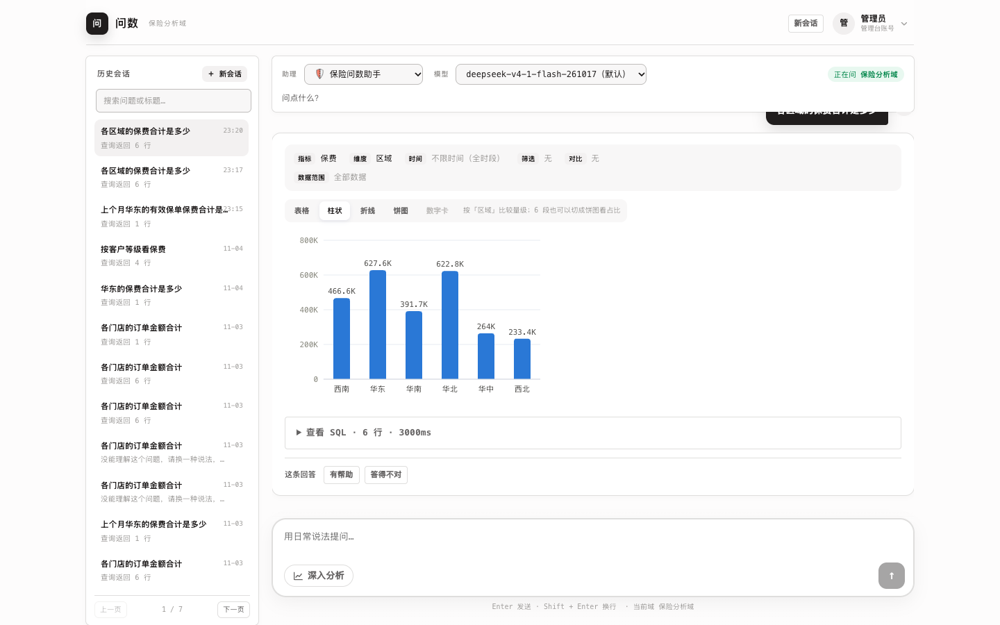
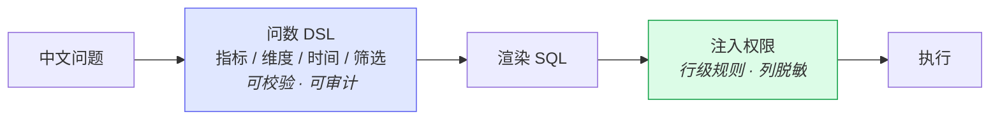
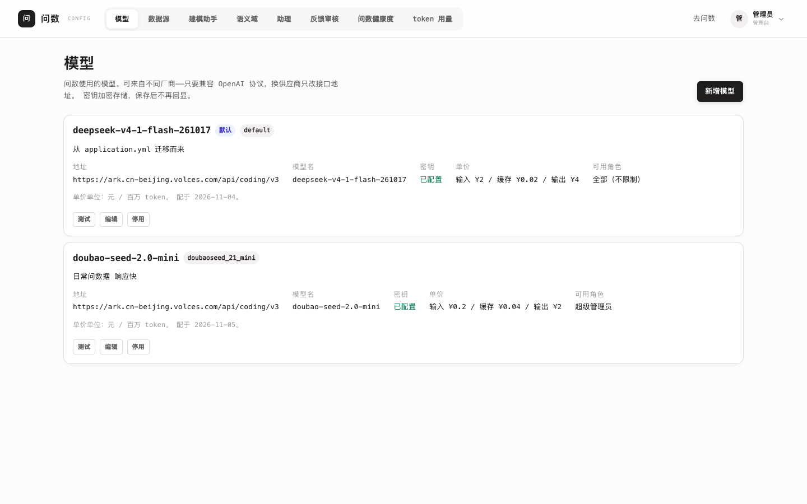
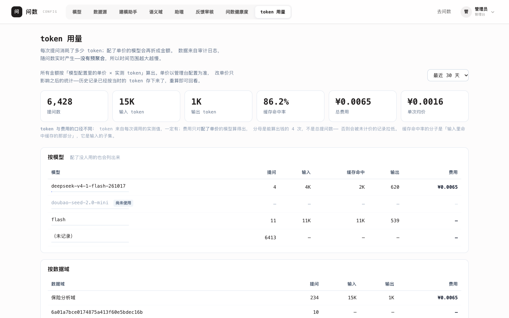
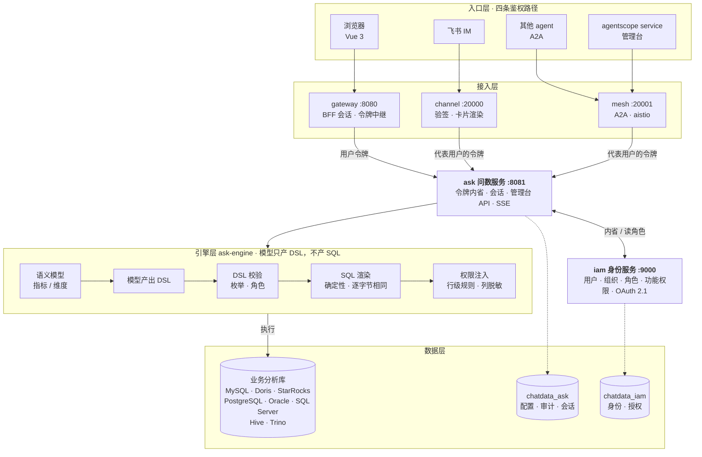

# chat-data-agent

**模型只产出查询意图，SQL 由确定性渲染器生成。**

业务人员用中文提问，得到表格、图表与结论。模型负责理解「查什么指标、按什么维度、
什么时间范围」，把它写成结构化的 DSL；SQL 由代码渲染，权限在渲染时固定注入。

> 模型碰不到 SQL，所以幻觉进不来，权限绕不过去，同一份配置永远生成同一句 SQL。

[](https://openjdk.org/projects/jdk/21/)
[](https://spring.io/projects/spring-boot)
[](https://github.com/agentscope-ai/agentscope-java)
[](LICENSE)



问一句「各区域的保费合计是多少」，得到图、数、SQL，以及**系统实际理解成了什么**
（指标、维度、时间、筛选、数据范围）。最后那一行是刻意放的——静默的语义错误是
这类系统最危险的失败方式，所以要让人一眼看见。

---

## 为什么不直接让模型写 SQL

市面上多数 NL2SQL 让模型直接生成 SQL。快，但错了不报错，只是数字不对，
而用户无从察觉。

这个项目在中间插了一层 DSL：



三个直接后果：

| | 让模型写 SQL | 本项目 |
|---|---|---|
| 模型能不能算错 | 能，且静默 | 不能——它只说「查什么」，不说「怎么查」 |
| 权限能不能保证 | 难以保证（SQL 是模型自由生成的） | 能——渲染器固定注入行级/列级规则 |
| 同一个问题两次结果 | 可能不同 | 同一份配置生成逐字节相同的 SQL |

还有一条不那么明显但很实用的：**DSL 让答案可复算**。口径改了之后，
拿历史 DSL 用新口径重跑一遍，就知道哪些旧结论会变。SQL 做不到这一点——
SQL 里没有「保费」这个概念，只有一个列名。

## 权限：五个账号，同一个问题，五个答案

这是最容易验证、也最难伪造的一件事。`demo/` 里有一套组织树，便利店订单落在门店级，
门店是叶子节点：

```
便利群 /1/100/        admin2     → 16800
├─ 华东子公司 /1/100/110/   zhangsan   → 3600
│  └─ …/120/ → …/130/
│     ├─ 上海门店1 …/140/   reviewer   → 1000   （分析师，精确匹配）
│     └─ 上海门店2 …/141/
└─ 华北子公司 /1/100/111/   auditor    → 4600
```

五个账号问**同一个问题**，得到的行数各不相同——而他们看到的是同一个域、
同一个助理、同一句话。权限不是在应用层过滤结果，是在**渲染 SQL 时**注入谓词：

```sql
-- reviewer（分析师，只到门店 140）实际执行的 SQL
SELECT … FROM order_detail t1
WHERE t1.org_code_path LIKE '/1/100/110/120/130/140/%'
```

有三条设计取向贯穿其中：

- **fail-closed**：动态变量取不到（比如没配 orgCode）时**拒绝查询**，
  而不是跳过规则放行。厂商在这里是跳过——那等于权限静默失效
- **权限不来自客户端**：角色与组织路径都从令牌内省结果解析。
  中文角色名走 HTTP 头会乱码，而乱码的表现是规则匹配不上 → 静默放行
- **渠道和 A2A 不判权限**：它们只负责「换一张代表该用户的令牌」，
  判定点只有一个。多一个判定点就多一处可能不一致的地方

## 管理台

<p>
  
  
</p>

左边是模型管理：多个模型、不同厂商、按角色白名单收敛、单价可配、连通性可测。
右边是 token 用量：每次提问花了多少、缓存命中率、折成多少钱。

两个设计上的取舍值得一提：

- **密钥只进不出**——保存后连密文都不回显，界面只有一个「已配置」
- **算不出钱时不写 0**——没配单价的模型显示「未配单价」，因为 0 元是「免费」，
  而这里是「不知道」，两者会让管理员得出相反的结论

## 功能

- **语义建模**：把物理表抽象成业务可理解的指标与维度，口径在建模层定死
- **建模助手**：选几张表 → 自动推断列角色、聚合与表间关联，生成**可编辑的域草稿**。
  支持同一物理列的**双登记**（维度管筛选、指标管聚合）
- **问数**：一句话得到表格 / 图表 / 结论；「我理解成了」回显系统实际理解的口径
- **分析编排**：把"为什么下降"这类问题拆成多步取数，再由 Java 算出确定性结论
- **权限**：行级规则（支持组织层级动态变量）、列级脱敏、fail-closed
- **审计**：每次提问、每步查询、每句 SQL 都可追溯
- **IM 渠道**：接入飞书，群里 @ 机器人即可问数；权限与 Web 端完全一致。
  支持**定时推送**（每天 9 点自动发数据）与卡片原地更新
- **运维可见性**：建模覆盖度（这个域缺什么配置）、健康度看板（整体成功率、
  失败原因排行、没人用的域）、质量分析（哪类问题在拖后腿）、
  **失败诊断**（能不能修、改哪里、或者为什么改配置也没用）
- **多数据源**：MySQL / Doris / StarRocks / PostgreSQL / Oracle / SQL Server；
  Hive 与 Trino 通过 `-Pbigdata` 启用
- **A2A**：注册到 Nacos 供其他 agent 发现；接入 agentscope 管理台可编排
- **评测基线**：203 条用例，分数据集报告通过率与失败原因

## 快速开始

需要 **Java 21**、**Maven**、**MySQL 8**、**Redis**。

```bash
# 1) 起依赖（默认非标准端口：MySQL 13306 / Redis 16379，
#    避免与本机已装的 3306/6379 撞车）
docker compose up -d

# 2) 配置
cp .env.example .env          # 填入数据库密码与 LLM API Key
set -a; . ./.env; set +a

# 3) 建库
mysql -uroot -p -e "
CREATE DATABASE chatdata_ask  DEFAULT CHARSET utf8mb4;
CREATE DATABASE chatdata_iam  DEFAULT CHARSET utf8mb4;
CREATE DATABASE chatdata_demo DEFAULT CHARSET utf8mb4;"
for f in sql/04-audit.sql sql/08-ask-engine.sql sql/10-ask-term-topic.sql \
         sql/11-ask-assistant.sql sql/12-ask-agent-session.sql \
         sql/14-ask-sql-example.sql \
         sql/16-ask-feedback.sql sql/17-ask-conversation.sql \
         sql/19-ask-audit-analysis.sql sql/20-ask-table-base-filter.sql \
         sql/21-channel.sql sql/22-channel-subscription.sql \
         sql/23-audit-health-index.sql sql/24-model-cost.sql
do mysql -uroot -p chatdata_ask < "$f"; done
mysql -uroot -p chatdata_ask < sql/09-ask-engine-seed.sql   # 演示数据（可选）

# 用 docker 起的库，种子里的数据源地址要改端口（库里存的是绝对地址）：
#   UPDATE ask_datasource SET url = REPLACE(url, ':3306/', ':13306/') WHERE id = 1;
mysql -uroot -p chatdata_iam < sql/iam/01-schema.sql
mysql -uroot -p chatdata_iam < sql/iam/07-role-permission.sql
mysql -uroot -p chatdata_iam < sql/iam/02-seed-dev.sql   # 建 admin / admin123
mysql -uroot -p chatdata_iam < sql/iam/08-bootstrap.sql  # 会打印角色与超管核对报告
mysql -uroot -p chatdata_iam < sql/25-ask-model-permission.sql  # 模型管理页的功能权限

# 4) 构建并启动
mvn -DskipTests package
java -jar chatdata-identity-service/target/chatdata-identity-service-*-SNAPSHOT.jar     &
java -jar chatdata-query-service/target/chatdata-query-service-*-SNAPSHOT.jar     &
java -jar chatdata-gateway/target/chatdata-gateway-*-SNAPSHOT.jar &

# 5) 可选：飞书渠道（需要飞书应用与公网回调地址，见文档）
# java -jar chatdata-channel/target/chatdata-channel-*-SNAPSHOT.jar &
```

打开 <http://127.0.0.1:8080/app/>，默认账号 `admin` / `admin123`。

> `08-bootstrap.sql` 最后会打印一份核对报告。**确认「超级管理员持有者数」>= 1**——
> 为 0 的话没人能进管理台。生产部署不要用 `02-seed-dev.sql` 里的固定密码。

**详细步骤、常见问题见 [docs/local-dev.md](docs/local-dev.md)。**

## 架构



**关键设计：模型只产 DSL，不产 SQL。** 所以权限能固定在渲染器里注入——
一旦 SQL 由模型自由生成，就没有安全的注入点。

三个入口，三条鉴权路径，最后都汇到 ask 由它统一判权限：

| 入口 | 怎么证明「我是谁」 |
|---|---|
| 浏览器 | 会话 Cookie + 网关 BFF |
| 飞书 | 事件验签，再换一张"代表该用户"的令牌 |
| 其他 agent / 管理台 | A2A 请求里的 `userId`，再按授权表换一张"代表该用户"的令牌 |

**渠道和 mesh 都不判断权限。** 渠道只做「哪个用户问了什么 → 拿他的令牌去问 → 把结果排版回去」；
mesh 只做「解析出代表谁 → 换令牌 → 转发给 ask」。
行级规则、列脱敏、角色判定全在 ask 里——它们看不到也不该看到。
这是刻意的：一旦它们开始判断"这个人能不能查"，就出现了第二个权限判定点。

| 模块 | 说明 |
|---|---|
| `chatdata-gateway` | 唯一入口：路由、BFF 会话、令牌中继 |
| `chatdata-query-service` | 问数服务：SSE、管理台 API、会话历史 |
| `chatdata-query-engine` | 问数引擎：语义模型、DSL、SQL 渲染、权限执行 |
| `chatdata-identity-service` | 身份：用户、组织、角色、功能权限、OAuth 2.1 |
| `chatdata-identity-client` | 服务间读取身份与目录的客户端 |
| `chatdata-channel` | IM 渠道：飞书 webhook 接入、卡片渲染、翻页与反馈 |
| `chatdata-mesh` | A2A agent：把问数暴露给其他 agent 调用，并接入 agentscope 管理台 |
| `chatdata-web` | 问数前端（Vue 3，产物打进 `chatdata-query-service`） |
| `chatdata-identity-web` | 账号中心前端（Vue 3，产物打进 `chatdata-identity-service`） |
| `chatdata-common` | 公共基础件：core / mybatis / redis（聚合 pom） |

## 文档

| 文档 | 内容 |
|---|---|
| [GLOSSARY.md](GLOSSARY.md) | 术语表（问数、语义建模、行级权限、直连模式…） |
| [docs/local-dev.md](docs/local-dev.md) | 本地启动：依赖、建库、环境变量、常见问题 |
| [docs/modeling-coverage.md](docs/modeling-coverage.md) | **建模覆盖度**：准确率最大的杠杆、新建域检查清单 |
| [docs/feishu-channel-setup.md](docs/feishu-channel-setup.md) | **飞书渠道接入**：建应用、配权限与回调、排障 |
| [docs/agentscope-local-build.md](docs/agentscope-local-build.md) | **本地构建 agentscope 管理台**：patch 用法、端口、排障 |
| [docs/adr/](docs/adr/) | 架构决策记录——每个决定的**为什么** |
| [docs/patches/](docs/patches/) | 外部依赖的补丁（agentscope service 本地构建） |
| [sql/README.md](sql/README.md) | 库的划分与建表顺序 |
| [eval/README.md](eval/README.md) | 评测基线：夹具、用例、指标口径、能力缺口 |
| [demo/adventureworks/](demo/adventureworks/) | 复杂业务域：28 表 / 172 列 / 30 关联的销售分析场景 |
| [AGENTS.md](AGENTS.md) | 给 AI agent 的工作约定 |

设计过程单独放在 [chatdata-agent-design](https://github.com/liusongboyy/chatdata-agent-design)：
每一轮功能的 spec、当时权衡的取舍、以及**被否决的方案**。
它不适合当入门材料读，但如果你想知道「为什么不做自动拆解路由」「为什么敏感列默认关闭」
这类问题，答案在那里。

## 开发

```bash
mvn test                                    # 1082 个测试
npm --prefix chatdata-web run build   # 前端（产物要一起提交，见下）
```

**前端产物必须提交。** Maven 不构建前端（没有 frontend-maven-plugin），
`src/main/resources/static/**` 里的文件是 `npm run build` 生成的。
删掉它们，clone 下来就是白屏。改了前端要重新 build 再提交。

## 工程证据

讲「可信」的系统很多，能拿出数字的少。这里是可核对的：

| 指标 | 数值 |
|---|---|
| 测试 | 1082 个，0 失败 |
| 引擎行覆盖率 | 71%（分支 58%） |
| 评测用例 | 203 条，分四个数据集 |
| 架构决策记录 | 11 份 ADR，每份写清**被否决的方案** |

其中几条测试是刻意连真库、真 agent 的，因为它们验的东西单测验不了：

- `UsageRealAgentTest` —— 真跑一遍 `ReActAgent`，确认 token 用量真的能采到。
  框架某次升级改了用量字段的落点，这条会红
- `EngineAuditMapperRealDbTest` —— 手写的 fake mapper 不解析 SQL，列序错了照样绿；
  只有真库能发现
- `ModelConfigReachesAskRealDbTest` —— **管理页配的模型真的出现在问数下拉里**。
  两侧各自的测试都绿，但中间那一环没人测，而它出错的方式都很安静
- `WebAppRouteCoverageTest` —— 解析前端 `router.ts`，断言每条静态路由都有 SPA 转发。
  漏一条的表现是「点进去正常、刷新 404」

## 一个真实的失败案例

问「上个月华东的**有效**保单保费合计」，系统返回空。

不是 bug——是「我理解成了」那块起了作用：

```
筛选  区域 = 华东  且  状态 = 有效
```

而库里 `status` 的取值是 `生效 / 已过期 / 退保`，**没有「有效」**。

这个例子说明了两件事：一是模型确实会按用户的措辞造值（`有效` 而不是 `生效`），
二是系统把它摊开在界面上，而不是安静地返回一个 0。

修法有两个方向：在语义层给 `status` 配同义词（`有效 → 生效`），
或者让模型看见列的真实取值。后者正是「列画像」在做的。

## 设计取向

这个项目里有几条反复出现的原则，看代码时会遇到：

1. **宁可拒绝，不要猜。** 字段有歧义、时间口径不明、权限规则求值失败——都直接拒绝，
   而不是选一个"看起来合理"的。猜错的表现是数字不对，而用户无从察觉。
2. **失败方向必须安全。** 没配授权 = 拒绝访问（不是放开）；认不出的聚合方式 = 报错（不是当维度）；
   敏感列默认关闭（不是默认开启）。
3. **不静默。** 降级要说明、截断要提示、理解错了要回显。「我理解成了」那一块就是为此存在的。
4. **可复现。** 同一份配置生成逐字节相同的 SQL；评测夹具改一次就重跑全量基线。

## 许可

[Apache License 2.0](LICENSE)
